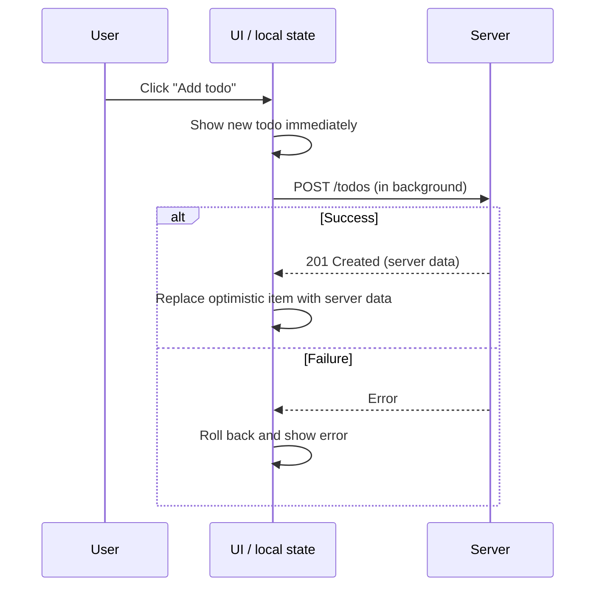

# Optimistic UI: What It Is and How to Implement It

## Introduction to Optimistic UI

**Optimistic UI is a pattern where the interface shows the result of a user action immediately, before the server has confirmed it, and only corrects itself if the request fails.** Instead of showing a spinner while waiting for the server, the app assumes success. Most requests do succeed.

A familiar example is the "like" button in social apps: the heart turns red the moment you tap it. The request to the server happens in the background. If it fails, the heart quietly turns grey again and an error is shown.

Optimistic updates make apps feel instant, because the perceived latency of an action drops from a network round trip (often hundreds of milliseconds) to a single render.

::: info What is optimistic UI?
Optimistic UI is a frontend pattern in which the interface applies the result of a user action immediately (an *optimistic update*), before the server confirms it, and rolls the change back if the request fails. It replaces loading spinners for everyday actions and makes apps feel instant.
:::

## Optimistic vs. Pessimistic UI

The opposite approach, waiting for the server before showing anything, is called *pessimistic UI*. Most apps use both, depending on the action:

| | Optimistic UI | Pessimistic UI |
|---|---|---|
| UI updates | immediately, before the server answers | after the server has confirmed |
| Perceived latency | one render | at least one network round trip |
| While waiting | nothing, or a subtle pending marker | spinner or disabled button |
| On failure | roll back and explain what happened | show an error, there is nothing to undo |
| Implementation | track pending changes, roll back, reconcile | simple |
| Best for | frequent actions that almost always succeed | payments, irreversible or server-dependent actions |

## Optimistic UI Examples

Optimistic UI is everywhere in modern apps. What makes each example work is a clear answer to the question "what happens if the request fails?":

| Action | Optimistic feedback | If the request fails |
|---|---|---|
| Liking a post | the icon fills and the counter goes up | revert both and show a short error |
| Sending a chat message | the message appears with a "sending" clock, then a check mark | mark it as failed with a retry button, keep the text |
| Adding an item to a list | the item appears at once, slightly faded | remove it and explain why, keep the input |
| Reordering with drag and drop | the card stays where it was dropped | animate it back to its old position |
| Toggling a setting | the switch flips immediately | flip it back and show an error |
| Editing text inline | the new text is shown with a "saving…" hint | keep the edited text in the field and show an error |

## How Optimistic Updates Work

Every optimistic update follows the same four steps:

1. **Apply locally**: update the UI state as if the action had succeeded, and remember what it looked like before.
2. **Send the request**: send the change to the server in the background.
3. **Reconcile**: when the server responds, replace the optimistic data with the server's version, for example to get the real ID or a server-side timestamp.
4. **Roll back on failure**: if the request fails, restore the previous state and tell the user.



The hard parts are steps 3 and 4: keeping track of which changes are still pending, applying server responses that arrive out of order, and rolling back correctly when several optimistic changes touch the same data.

### Rolling Back: Snapshots vs. Optimistic Layers

The most common way to roll back is a snapshot: remember the state before the update and restore it if the request fails.

```js
async function toggle(id) {
  const snapshot = todos
  todos = todos.map(todo => (todo.id === id ? { ...todo, done: !todo.done } : todo))
  render()
  try {
    await api.toggleTodo(id)
  } catch {
    todos = snapshot // also reverts every change made after the snapshot
    render()
  }
}
```

This works as long as only one update is in flight. Toggle two todos quickly, and let the first request fail while the second succeeds: restoring the first snapshot also reverts the second toggle. The UI now shows the second todo as open, although the server has saved it as done.

The robust alternative is to keep the confirmed server state and the pending changes apart, and to derive what the user sees from both. Each optimistic change is a *layer* on top of the confirmed state:

```js
let confirmed = [] // the last state confirmed by the server
let pending = [] // optimistic changes that are still in flight

const visibleTodos = () => pending.reduce((todos, change) => change(todos), confirmed)

async function toggle(id) {
  const change = todos => todos.map(todo => (
    todo.id === id ? { ...todo, done: !todo.done } : todo
  ))
  pending = [...pending, change]
  render()
  try {
    await api.toggleTodo(id)
    confirmed = change(confirmed)
  } catch (error) {
    showError(error.message)
  } finally {
    pending = pending.filter(item => item !== change)
    render()
  }
}
```

A failed change now only removes its own layer, and changes that are still pending stay visible. When the server sends new data, `confirmed` is replaced and the pending changes are applied on top of it again. This is how React's `useOptimistic`, Apollo Client and Convex keep optimistic state, and it is what a local database with a sync queue does for every write ([see below](#the-connection-between-local-databases-and-optimistic-ui)).

## When to Use Optimistic UI

Optimistic UI works best when:

- the action **almost always succeeds** (likes, toggles, reordering, adding items to a list, editing text);
- a failure is **cheap to undo** and easy to explain to the user;
- the user benefits from **continuing immediately**, for example when adding several items in a row.

Avoid it, or show explicit pending states instead, when:

- the outcome **depends on the server** (payments, bookings, stock availability, permission checks);
- the action is **irreversible** or has side effects outside the app (sending an email, publishing);
- a rollback would **destroy user input** that is hard to recreate.

## Common Pitfalls of Optimistic Updates

Most bugs in optimistic interfaces come from a handful of situations:

- **Out-of-order responses**: a refetch that started before your update can arrive after it and overwrite the optimistic value with stale data. Cancel or ignore reads that are in flight while a mutation is pending (TanStack Query's `cancelQueries` in `onMutate` does exactly this), or compare versions.
- **Temporary IDs**: an item created optimistically needs an ID before the server has assigned one. If the ID changes on confirmation, a list keyed by ID remounts the element, focus and animations are lost, and an edit or delete issued in the meantime refers to an ID the server does not know. Generate IDs on the client, for example with `crypto.randomUUID()`, and let the server accept them.
- **Retries and duplicates**: retrying a request whose response was lost can create the same item twice. Make writes idempotent with client-generated IDs or an idempotency key that the server deduplicates.
- **Rollbacks that destroy input**: reverting a long comment or form because of a validation error loses the user's work. Keep the input, mark the item as failed, and offer a retry.
- **Leaving before the request finishes**: pending changes that only exist in memory are lost when the tab is closed or the device goes offline, although the user already saw them as saved. Persist pending changes, for example in a local database with a sync queue, or warn before unloading the page while requests are pending.
- **Silent failures**: an update that quietly disappears is worse than a spinner. Always tell the user when a change has been rolled back.

## Optimistic Updates in React: useOptimistic and React Query

In React, there are two common ways to implement optimistic updates for a single mutation.

### React's useOptimistic Hook

**React's `useOptimistic` hook** (React 19) shows a temporary state while an async action is running:

```jsx
import { useOptimistic } from 'react'

function TodoList({ todos, addTodo }) {
  const [optimisticTodos, addOptimisticTodo] = useOptimistic(
    todos,
    (state, newTodo) => [...state, { ...newTodo, pending: true }],
  )

  async function formAction(formData) {
    const todo = { id: crypto.randomUUID(), title: formData.get('title') }
    addOptimisticTodo(todo)
    await addTodo(todo) // when this settles, optimisticTodos falls back to todos
  }

  return (
    <form action={formAction}>
      {optimisticTodos.map(todo => (
        <p key={todo.id} style={{ opacity: todo.pending ? 0.5 : 1 }}>{todo.title}</p>
      ))}
      <input name="title" />
    </form>
  )
}
```

The optimistic state only exists while the Action runs, so the setter has to be called inside an Action or `startTransition` (a form `action` already is one). When `addTodo` settles, successfully or not, `optimisticTodos` falls back to `todos`. The rollback is automatic, but showing an error message is up to you.

### TanStack Query (React Query)

**TanStack Query (React Query)** offers two approaches. The simpler one renders the pending mutation's `variables` next to the list, without touching the cache:

```jsx
const { isPending, isError, variables, mutate } = useMutation({
  mutationFn: addTodo,
  onSettled: (data, error, variables, onMutateResult, context) =>
    context.client.invalidateQueries({ queryKey: ['todos'] }),
})

// in the list
{isPending && <li style={{ opacity: 0.5 }}>{variables.title}</li>}
{isError && (
  <li>
    {variables.title} <button onClick={() => mutate(variables)}>Retry</button>
  </li>
)}
```

The other writes the optimistic value into the query cache, so every component that reads the query updates. It uses the `onMutate`, `onError` and `onSettled` callbacks of a mutation: write the optimistic value into the query cache in `onMutate`, restore the snapshot in `onError`, and refetch in `onSettled`:

```jsx
useMutation({
  mutationFn: addTodo,
  onMutate: async (newTodo, context) => {
    await context.client.cancelQueries({ queryKey: ['todos'] })
    const previousTodos = context.client.getQueryData(['todos'])
    context.client.setQueryData(['todos'], old => [...old, newTodo])
    return { previousTodos }
  },
  onError: (error, newTodo, onMutateResult, context) => {
    context.client.setQueryData(['todos'], onMutateResult.previousTodos)
  },
  onSettled: (data, error, variables, onMutateResult, context) =>
    context.client.invalidateQueries({ queryKey: ['todos'] }),
})
```

This is the snapshot approach from above. The refetch in `onSettled` is what keeps it correct when several mutations overlap: a restored snapshot can briefly undo a newer optimistic change, and the refetch replaces it with the server's state.

Both approaches work well for individual actions, but they have the same limits:

- Optimistic state lives **per mutation or per component**, and you write the rollback logic yourself.
- Pending changes are **lost on reload**, and nothing works **offline**.
- Every view that shows the same data has to be updated separately.

## Optimistic Updates in Other Libraries

Most data-fetching libraries have a built-in way to apply optimistic updates:

| Library | Optimistic update | Rollback |
|---|---|---|
| [SWR](https://swr.vercel.app/docs/mutation#optimistic-updates) | `mutate(key, updateFn, { optimisticData })` | automatic, controlled by `rollbackOnError` (default `true`) |
| [Apollo Client](https://www.apollographql.com/docs/react/performance/optimistic-ui) | `optimisticResponse` option of a mutation | the optimistic layer is discarded on error |
| [RTK Query](https://redux-toolkit.js.org/rtk-query/usage/manual-cache-updates#optimistic-updates) | `api.util.updateQueryData()` in `onQueryStarted` | `patchResult.undo()` when `queryFulfilled` rejects |
| [Convex](https://docs.convex.dev/client/react/optimistic-updates) | `useMutation(…).withOptimisticUpdate(…)` | rolled back automatically when the mutation completes |
| [React](https://react.dev/reference/react/useOptimistic) | `useOptimistic` | reverts when the Action ends |
| [TanStack Query](https://tanstack.com/query/latest/docs/framework/react/guides/optimistic-updates) | `setQueryData` in `onMutate`, or the mutation's `variables` | restore the snapshot in `onError` |

Outside React, TanStack Query's adapters for Vue, Svelte, Solid and Angular support the same `onMutate` pattern. Native apps follow the same four steps, whatever the framework.

## Understanding Local Databases

A local database stores application data on the user's device, for example in the browser's IndexedDB or OPFS, or in SQLite on mobile, and answers queries without a network round trip. Many local databases can also **replicate** data from a server: they keep a local copy in sync with the backend in both directions.

This changes how optimistic UI works.

## The Connection Between Local Databases and Optimistic UI

With a local database, the UI does not render server responses. It renders the result of **local queries**. Every write goes to the local database first, and the database syncs with the server in the background.

That makes every write optimistic by default:

- **Apply locally**: writing to the local database *is* the optimistic update. Every view that queries the affected data updates, not just the component that triggered the action.
- **Send the request**: the sync layer pushes the change and keeps it queued (and persisted) until the server accepts it, even across reloads and offline periods.
- **Reconcile and roll back**: after a push, the next pull brings the server's version of the data into the local database. If the server rejected a change, the server state replaces the local change, which acts as a rollback.

Because pending changes are kept in a log and replayed on top of every new server state, this is the [optimistic layer approach](#rolling-back-snapshots-vs-optimistic-layers): a rejected change disappears without touching any other pending change.

This is the core idea of [offline-first](/offline-first/) and local-first apps: the UI never waits for the network.

## Optimistic UI with SignalDB

[SignalDB](/getting-started/) is a reactive local database that implements this pattern. Queries run inside your framework's effects are reactive, so a local write updates the UI immediately:

```js
import { Collection, DefaultDataAdapter } from '@signaldb/core'
import { SyncManager } from '@signaldb/sync'
import createIndexedDBAdapter from '@signaldb/indexeddb'
import solidReactivityAdapter from '@signaldb/solid'

const dataAdapter = new DefaultDataAdapter({
  storage: createIndexedDBAdapter({
    databaseName: 'my-app',
    version: 1,
    schema: {
      'todos': [],
      // stores the SyncManager keeps its change queue in
      'app-changes': ['collectionName'],
      'app-snapshots': ['collectionName'],
      'app-sync-operations': ['collectionName', 'status'],
    },
  }),
})

const todos = new Collection('todos', dataAdapter, {
  reactivity: solidReactivityAdapter,
})

const syncManager = new SyncManager({
  id: 'app',
  dataAdapter,
  pull: async ({ apiPath }) => ({ items: await fetch(apiPath).then(res => res.json()) }),
  push: async ({ apiPath }, { changes }) => {
    const response = await fetch(apiPath, { method: 'POST', body: JSON.stringify(changes) })
    if (response.status >= 400 && response.status < 500) {
      // validation error: don't retry; the next pull restores the server state
      showError(await response.text())
      return
    }
    if (!response.ok) throw new Error('Push failed') // network/server error: retried on next sync
  },
})
syncManager.addCollection(todos, { name: 'todos', apiPath: '/api/todos' })

// In your UI: the new todo appears instantly, before the server has answered
await todos.insert({ title: 'Write docs', completed: false })
```

- **Instant updates everywhere**: every reactive query that matches the new todo re-runs, in every component.
- **Retries and offline**: if the push fails because of a network or server error, the change stays queued and is pushed again on the next sync, also after a reload.
- **Rollback for rejected changes**: validation errors are handled in `push`; the following pull replaces the local data with the server's version.
- **Conflicts**: local changes are replayed on top of the latest server data, and the most recent change wins (see [Sync Flow & Conflict Resolution](/sync/#sync-flow-conflict-resolution)).

SignalDB works with the signals of your framework. See the guides for [React](/guides/react/), [Vue](/guides/vue/), [Angular](/guides/angular/), [Svelte](/guides/svelte/) and [Solid](/guides/solid-js/), or the examples for [Supabase](/supabase/) and [Firebase](/firebase/).

## Improving User Experience with Optimistic UI

A few UX details make optimistic interfaces trustworthy:

- **Mark pending items subtly**, for example with reduced opacity or a small sync icon, so users know a change has not reached the server yet.
- **Explain rollbacks**: when a change is reverted, say why ("Couldn't save: title is required") and, if possible, keep the user's input so it can be fixed.
- **Show global sync state**: a small "Saving…/All changes saved" indicator is enough. With SignalDB, `syncManager.isSyncing()` can drive it directly. It is reactive when you pass a reactivity adapter to the `SyncManager`.
- **Don't fake irreversible actions**: for payments or sends, show a real pending state instead.

## Real-time UI Updates with Local Databases

Optimistic UI covers *your own* changes. Changes from other users or devices arrive through sync: with live updates (WebSockets or server-sent events), the server notifies the client, the client pulls the new data into the local database, and every reactive query updates. Local writes and remote changes go through the same path, so the UI code doesn't care where a change came from. See [Real-Time Web Apps](/real-time/) and [Live Updates](/live-updates/) for the underlying techniques.

## Frequently Asked Questions

### What is optimistic UI?

A UI pattern that shows the result of an action immediately, assuming it will succeed, and rolls it back if the server reports an error.

### What is the difference between optimistic and pessimistic UI?

A pessimistic UI waits for the server's confirmation before showing the result, usually with a spinner. An optimistic UI shows the result first and confirms or corrects it afterwards. See the [comparison table](#optimistic-vs-pessimistic-ui).

### How do you roll back an optimistic update?

Keep the previous state (or the list of pending changes) until the server confirms the change. If the request fails, restore that state. With a local database and sync, the next pull from the server restores the authoritative state automatically.

### What is the difference between optimistic UI and optimistic locking?

Optimistic locking is a concurrency control technique on the server: a write only succeeds if the record has not changed since it was read, otherwise it is rejected. Optimistic UI is a frontend pattern. Both assume that conflicts are rare and deal with them when they happen, and they work well together: the server rejects a stale write, and the client rolls back its optimistic update.

### Is optimistic UI the same as offline-first?

No, but they are closely related. Optimistic UI is about not waiting for the server for a single action. [Offline-first](/offline-first/) applies the same idea to the whole app: all reads and writes are local, and sync runs in the background.

## Conclusion

Optimistic UI makes apps feel instant by showing the result of an action before the server confirms it. For single actions, React's `useOptimistic` or React Query's mutation callbacks are enough. When updates overlap, keep pending changes as layers on top of the confirmed state instead of restoring snapshots. When many views share the same data, or the app should keep working offline, a reactive local database such as [SignalDB](/getting-started/) makes every write optimistic by default and handles retries, persistence and reconciliation for you.
