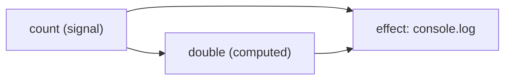

---
head:
- - link
  - rel: canonical
    href: https://signaldb.js.org/signals/
- - meta
  - name: og:type
    content: article
- - meta
  - name: og:url
    content: https://signaldb.js.org/signals/
- - meta
  - name: og:title
    content: 'JavaScript Signals Explained: How They Work, with Examples'
- - meta
  - name: og:description
    content: What JavaScript signals are and how they work, with a signal built from scratch, signals vs. observables, framework APIs and the TC39 Signals proposal.
- - meta
  - name: description
    content: What JavaScript signals are and how they work, with a signal built from scratch, signals vs. observables, framework APIs and the TC39 Signals proposal.
- - meta
  - name: keywords
    content: JavaScript signals, js signals, signals javascript, how signals work, TC39 signals proposal, signal polyfill, signals vs observables, Preact signals, Angular signals, Solid signals, Vue signals, Svelte runes, alien-signals, fine-grained reactivity, SignalDB
---
# JavaScript Signals Explained

## Introduction

**JavaScript signals are reactive values: when a signal changes, everything that reads it (computed values, effects, UI) updates automatically, and nothing else does.** They are the reactivity primitive behind Solid, Angular, Preact, Vue's refs and Svelte's runes, and a [TC39 proposal](#the-tc39-signals-proposal) aims to make them part of the language.

```js
import { signal, computed, effect } from '@preact/signals-core'

const count = signal(0)
const double = computed(() => count.value * 2)

effect(() => {
  console.log(`count: ${count.value}, double: ${double.value}`)
}) // logs "count: 0, double: 0"

count.value = 1 // logs "count: 1, double: 2"
```

This article explains how JavaScript signals work under the hood, [builds a minimal signal from scratch](#build-a-minimal-signal-in-javascript), compares signals with observables, shows the signal APIs of popular frameworks and the [most common pitfalls](#common-pitfalls-with-signals), and shows how you can use signals for more than UI state, for example to [query a local database reactively](#signals-beyond-ui-state-a-reactive-database).

::: info What are JavaScript signals?
JavaScript signals are reactive primitives that represent values over time and automatically notify everything that depends on them when they change, enabling fine-grained reactivity without manual subscriptions.
:::

## Understanding Signals in JavaScript

Almost every signal implementation is built from three primitives:

- **Signal** (also called *state*, *ref* or *atom*): holds a value that can be read and written.
- **Computed** (also called *memo* or *derived*): a value derived from other signals. It is cached and only recalculated when one of its dependencies changes.
- **Effect**: a function that runs side effects such as rendering, logging or network calls, and re-runs whenever a signal it read has changed.

Together they form a dependency graph: signals are the sources, computed values sit in the middle, and effects are the leaves that touch the outside world. You never wire up this graph by hand. Reading a signal inside a computed value or an effect is enough to subscribe to it.

Despite the name, JavaScript signals are unrelated to [`AbortSignal`](https://developer.mozilla.org/en-US/docs/Web/API/AbortSignal), to process signals such as `SIGINT` in Node.js, and to the `js-signals` event library. See [where the name comes from](#early-beginnings-in-software-engineering).

### Signals and Reactive Programming

[Reactive programming](https://en.wikipedia.org/wiki/Reactive_programming) is a declarative programming paradigm concerned with data streams and the propagation of change. In JavaScript, this involves:

- **Reactive sources**: values or streams that can be observed.
- **Dependents**: computations or components that react to changes of those sources.
- **Automatic updates**: when a source changes, its dependents update without explicit commands to re-render or re-fetch.

Signals are the "current value" flavour of reactive programming: a signal always has a value, and dependents are tracked automatically.

### Role of the Effect Function in Signals

The `effect` function is the bridge between reactive data and the outside world:

- **Automatic updates**: an effect re-runs whenever a signal it read during its last run changes.
- **Dependency tracking**: it records which signals were read while it ran, so only relevant changes trigger a re-run.
- **Resource management**: most implementations let an effect return or register a cleanup function that runs before the next execution and when the effect is disposed, which is the place to remove event listeners or close subscriptions.

Effects are meant for side effects. To keep one value in sync with another, use a computed value instead ([see the pitfalls](#writing-to-signals-inside-effects)).

## How Signals Work - Technical Perspective

Every signal library does two jobs: it records which computations read which signals, and when a signal is written, it re-runs exactly those computations, in an order that never exposes an inconsistent state.

### Signal Creation and Propagation

At its core, a signal holds a value and a set of subscribers. Writing a new value marks the subscribers as stale and schedules them to re-run. For the example from the introduction, the dependency graph looks like this:



When `count` changes, both `double` and the effect are stale. The effect has to run exactly once, and only after `double` has been recalculated. Getting this right is the hard part of a signal implementation, as the next sections show.

### Dependency Tracking

When a signal is read inside a reactive context, such as an effect or a computed value, the runtime records it as a dependency of that context. This is usually implemented with a global "currently running computation" pointer: every signal read checks the pointer and adds the running computation to its subscribers.

Dependencies are collected again on every run. If an effect reads `user.value` only while `isLoggedIn.value` is `true`, it depends on `user` only while the user is logged in. This is why signals need no dependency arrays, unlike React's `useEffect`.

### Build a Minimal Signal in JavaScript

The quickest way to understand signals is to build one. The following implementation of `signal`, `computed` and `effect` uses the same `.value` API as Preact Signals, so the example from the introduction runs against it unchanged:

```js
let currentEffect = null

function signal(initialValue) {
  let value = initialValue
  const subscribers = new Set()
  return {
    get value() {
      if (currentEffect) subscribers.add(currentEffect)
      return value
    },
    set value(newValue) {
      if (Object.is(newValue, value)) return
      value = newValue
      for (const subscriber of [...subscribers]) subscriber()
    },
  }
}

function effect(fn) {
  const run = () => {
    const previous = currentEffect
    currentEffect = run
    try {
      fn()
    } finally {
      currentEffect = previous
    }
  }
  run()
}

function computed(fn) {
  const result = signal(undefined)
  effect(() => {
    result.value = fn()
  })
  return {
    get value() {
      return result.value
    },
  }
}
```

Reading `.value` while an effect runs subscribes that effect, and writing `.value` re-runs every subscriber. Running the introduction example against it shows where this simple approach falls short:

```js
const count = signal(0)
const double = computed(() => count.value * 2)

effect(() => {
  console.log(`count: ${count.value}, double: ${double.value}`)
}) // logs "count: 0, double: 0"

count.value = 1
// logs "count: 1, double: 2"
// logs "count: 1, double: 2" a second time
```

The effect runs twice for a single write: once because `double` changed and once because `count` changed. This version also never drops old dependencies, cannot dispose an effect, and re-runs everything synchronously on every write. Production libraries solve exactly these problems:

- **Glitch-free updates**: each computation runs at most once per change, after all of its dependencies are up to date ([see below](#efficient-state-management)).
- **Dynamic dependencies**: subscriptions from the previous run are dropped, so a branch that is no longer taken stops triggering updates.
- **Disposal**: an effect can be stopped, and frameworks stop a component's effects when it unmounts.
- **Batching and scheduling**: several writes can be grouped so that effects run only once.

### Efficient State Management

The double run above is known as the *diamond problem*: `count` reaches the effect over two paths. A naive push-based implementation runs the effect once per path, and if the paths are notified in the wrong order, the effect even sees the new `count` together with the old `double`. Such a temporarily inconsistent state is called a *glitch*.

Modern libraries avoid both with a **push-pull** algorithm:

1. **Push**: a write only marks its dependents as *dirty* (or *possibly dirty*), all the way down the graph. Nothing is recalculated yet.
2. **Pull**: when an effect runs or a computed value is read, the library walks back up the graph and recalculates only the computed values whose sources actually changed. If a computed value produces the same result as before, propagation stops there.

This makes computed values lazy and cached, and guarantees that every effect runs once per change and never observes an inconsistent state. Preact Signals implements this with version numbers and linked lists. [alien-signals](https://github.com/stackblitz/alien-signals) is a particularly fast push-pull implementation, and Vue 3.6 (in beta as of October 2026) rebuilds its reactivity core on the alien-signals algorithm.

### Batching and Untracked Reads

Two more tools are part of almost every signal library. **Batching** groups several writes so that effects run once, with the final state:

```js
import { batch, effect, signal } from '@preact/signals-core'

const firstName = signal('Ada')
const lastName = signal('Lovelace')

effect(() => console.log(`${firstName.value} ${lastName.value}`)) // logs "Ada Lovelace"

batch(() => {
  firstName.value = 'Grace'
  lastName.value = 'Hopper'
}) // logs "Grace Hopper" once, never "Grace Lovelace"
```

Frameworks that schedule effects asynchronously, such as Angular, Vue and Svelte, batch synchronous writes automatically.

**Untracked reads** read a signal without subscribing to it, for values an effect needs but should not react to:

```js
import { effect, signal, untracked } from '@preact/signals-core'

const query = signal('signals')
const page = signal(1)

effect(() => {
  console.log(`search "${query.value}" on page ${untracked(() => page.value)}`)
}) // logs 'search "signals" on page 1'

page.value = 2 // no log: the effect does not depend on page
query.value = 'observables' // logs 'search "observables" on page 2'
```

The name varies by library: `peek()` and `untracked()` in Preact, `untracked()` in Angular, `untrack()` in Solid and Svelte, and `Signal.subtle.untrack()` in the TC39 proposal.

### Integration with the UI

In signal-based frameworks, the renderer itself is an effect. Solid and Svelte 5 compile templates into small effects that update individual DOM nodes, so components run once and there is no virtual DOM to diff. Angular uses the signals read in a template to decide which components to refresh. Preact and Vue still render components with a virtual DOM, but signals limit re-rendering to the components that read a changed value, and Preact can bind a signal directly to a text node. In every case, signals remove most of the glue code that is otherwise needed to keep UI and state in sync.

## When to Use JavaScript Signals

Signals pay off wherever state is read in many places and changes often. Consider using signals for:

- **UI state** that several parts of the page read: form values, filters, the current selection, the theme.
- **Derived data** that has to stay in sync: totals, filtered or sorted lists, validation results.
- **Large, frequently updating views** such as dashboards, tables and editors, where re-rendering whole component trees is too slow.
- **State shared across components**, without prop drilling or context providers.
- **Framework-independent logic**: a signal works the same in a component, a store or a plain module, and is easy to test.

Signals are less useful for one-off values that never change, or for modelling sequences of events over time (clicks, WebSocket messages, debounced input). Those are better expressed as [observables or event streams](#signals-vs-observables).

### Benefits of Using Signals in JavaScript

- **Fine-grained updates**: only the computations and DOM nodes that depend on a changed value are updated.
- **No manual subscriptions**: dependencies are tracked automatically, so there is nothing to forget to unsubscribe.
- **Decoupled components**: state can live outside components and be shared without prop drilling or global stores.
- **Readable data flow**: derived values are declared once with `computed` instead of being kept in sync by hand.

## Signals vs. Observables

Signals and observables (for example [RxJS](https://rxjs.dev/)) are both reactive, but they model different things:

| | Signals | Observables (RxJS) |
|---|---|---|
| Represents | a value that changes over time | a stream of events over time |
| Current value | always available (`count.value`, `count()`) | not by default (only e.g. `BehaviorSubject`) |
| Dependency tracking | automatic, by reading the signal | explicit, via `subscribe()` and operators |
| Unsubscribing | handled by the effect's lifecycle | manual, or via operators like `takeUntil` |
| Timing and async | synchronous and glitch-free by design | built for async: `debounceTime`, `switchMap`, retries |
| Typical use | UI state, derived data, query results | user input streams, WebSockets, request orchestration |

**Rule of thumb:** use signals for *state* that the UI reads, and observables for *events* that need time-based operators. Many apps use both. Angular, for example, ships `toSignal()` and `toObservable()` in `@angular/core/rxjs-interop` to convert between them.

## Signals in Popular Frameworks

Every major framework now has a signal-like primitive, under different names:

| Framework / library | Create | Derive | Effect | SignalDB adapter |
|---|---|---|---|---|
| [Solid](https://docs.solidjs.com/concepts/signals) | `createSignal(0)` | `createMemo(() => …)` | `createEffect(() => …)` | [`@signaldb/solid`](/reference/solid/) |
| [Angular](https://angular.dev/guide/signals) | `signal(0)` | `computed(() => …)` | `effect(() => …)` | [`@signaldb/angular`](/reference/angular/) |
| [Vue](https://vuejs.org/guide/essentials/reactivity-fundamentals.html) | `ref(0)` | `computed(() => …)` | `watchEffect(() => …)` | [`@signaldb/vue`](/reference/vue/) |
| [Preact Signals](https://preactjs.com/guide/v10/signals/) | `signal(0)` | `computed(() => …)` | `effect(() => …)` | [`@signaldb/preact`](/reference/preact/) |
| [Svelte 5 runes](https://svelte.dev/docs/svelte/what-are-runes) | `$state(0)` | `$derived(…)` | `$effect(() => …)` | [`@signaldb/svelte`](/reference/svelte/) |
| [MobX](https://mobx.js.org/) | `observable(…)` | `computed(() => …)` | `autorun(() => …)` | [`@signaldb/mobx`](/reference/mobx/) |
| [Qwik](https://qwik.dev/docs/components/state/) | `useSignal(0)` | `useComputed$(() => …)` | `useTask$(({ track }) => …)` | – |
| [alien-signals](https://github.com/stackblitz/alien-signals) | `signal(0)` | `computed(() => …)` | `effect(() => …)` | [custom adapter](/reference/core/createreactivityadapter/) |
| TC39 proposal | `new Signal.State(0)` | `new Signal.Computed(() => …)` | none built in ([see below](#the-tc39-signals-proposal)) | – |

Two of these are changing. **Solid 2.0**, a release candidate as of October 2026, keeps `createSignal` and `createMemo` but splits `createEffect` into a tracked function that reads signals and an untracked function that performs the side effect. **Vue 3.6** (beta) rebuilds its reactivity core on the alien-signals algorithm while keeping the `ref` and `computed` API.

**React** has no built-in signals: `useState` re-renders the whole component. You can add signals with a library such as `@preact/signals-react`. SignalDB's [React integration](/guides/react/) wraps any signal library's `effect` in a `useReactivity` hook.

A full list of supported libraries is on the [Reactivity](/reactivity/#reactivity-libraries) page.

## Common Pitfalls with Signals

Signals remove a lot of bookkeeping, but a few mistakes come up again and again. The examples use Preact Signals, but the same rules apply to every library.

### Reading a Signal Outside a Reactive Context

Reading `.value` returns a plain value. Only reads inside an effect, a computed value or a component render are tracked:

```js
const count = signal(0)
const snapshot = count.value // a number, not a signal

effect(() => console.log(snapshot)) // logs 0, and never again
count.value = 1
```

The same applies to destructuring and to passing values around: hand the signal itself (or a getter) to code that should stay reactive, and read it as late as possible. Destructuring props in Solid, or a `reactive()` object in Vue, loses reactivity for the same reason.

### Mutating Objects in Place

A signal notifies its dependents when it is assigned a new value. Changing an object or array it holds does not count:

```js
const todos = signal(['Write docs'])

effect(() => console.log(todos.value.length)) // logs 1

todos.value.push('Ship it') // no log: still the same array
todos.value = [...todos.value, 'Celebrate'] // logs 3
```

Assign a new object or array instead, or use a library with deep reactivity, such as Vue's `ref()`, Svelte 5's `$state` or MobX observables, which track property access through proxies.

### Writing to Signals Inside Effects

An effect that writes a signal it also reads triggers itself. Preact throws `Cycle detected`, other libraries loop or warn. Even without a cycle, an effect that copies one value into another signal causes an extra update, and the copy lags behind its source whenever effects are batched or scheduled. Derive the value instead:

```js
// Avoid: an effect that copies state into another signal
const fullNameCopy = signal('')
effect(() => {
  fullNameCopy.value = `${firstName.value} ${lastName.value}`
})

// Prefer: a computed value, always consistent and only calculated when read
const fullName = computed(() => `${firstName.value} ${lastName.value}`)
```

### Forgetting to Dispose Effects

An effect stays subscribed to its signals until it is disposed. Frameworks dispose a component's effects when it unmounts, but effects you create yourself, in a store, a module or a test, run until you stop them:

```js
const dispose = effect(() => console.log(count.value))

// later, when the effect is no longer needed
dispose()
```

An effect that is never disposed keeps running and keeps its callback, and everything the callback references, in memory.

## The TC39 Signals Proposal

The [TC39 Signals proposal](https://github.com/tc39/proposal-signals) aims to add a standard `Signal` primitive to JavaScript itself. It reached **Stage 1** in April 2024 and is still at Stage 1 as of October 2026: TC39 is exploring the problem space, and the API can still change significantly. To reach Stage 2, the committee would have to settle on a preferred design backed by draft specification text.

The proposal was started by Rob Eisenberg and Daniel Ehrenberg, with design input from the maintainers of Angular, Ember, MobX, Preact, Qwik, RxJS, Solid, Svelte, Vue and others. Its authors compare it to Promises/A+, the community specification that preceded native promises in ES2015: first align the ecosystem on one model, then standardize it.

The proposed API has two core classes:

```js
const counter = new Signal.State(0)
const isEven = new Signal.Computed(() => (counter.get() & 1) === 0)
const parity = new Signal.Computed(() => (isEven.get() ? 'even' : 'odd'))

counter.set(1)
parity.get() // 'odd'
```

Key points:

- **It is meant for frameworks, not primarily for app code.** The goal is a shared, interoperable signal graph that frameworks can build on, so that signals from one library can be used in another.
- **There is no built-in `effect`.** Effect scheduling is tied to each framework's rendering cycle, so the proposal only provides a low-level `Signal.subtle.Watcher`. A minimal effect on top of it, adapted from the polyfill's README, re-runs callbacks in a microtask:

  ```js
  import { Signal } from 'signal-polyfill'

  let needsEnqueue = true

  const watcher = new Signal.subtle.Watcher(() => {
    if (needsEnqueue) {
      needsEnqueue = false
      queueMicrotask(processPending)
    }
  })

  function processPending() {
    needsEnqueue = true
    for (const pending of watcher.getPending()) pending.get()
    watcher.watch()
  }

  export function effect(callback) {
    let cleanup
    const computed = new Signal.Computed(() => {
      if (typeof cleanup === 'function') cleanup()
      cleanup = callback()
    })
    watcher.watch(computed)
    computed.get()
    return () => {
      watcher.unwatch(computed)
      if (typeof cleanup === 'function') cleanup()
    }
  }
  ```

- **Options and escape hatches are explicit.** Both classes accept an `equals` option that decides when a new value counts as a change. `Signal.subtle` holds the `Watcher`, `untrack()` and introspection helpers for devtools; the `subtle` namespace marks APIs meant for library authors.
- **You can try it today** with the [`signal-polyfill`](https://github.com/proposal-signals/signal-polyfill) package (version 0.2 as of October 2026), which its README explicitly marks as not for production use.

If the proposal advances, framework-specific signals would become thin wrappers around a native primitive, and libraries such as SignalDB could support all of them through a single integration.

## Signals Beyond UI State: a Reactive Database

Signals work well for individual values. Application data, however, is usually a *collection of records* that you filter, sort, persist and sync with a server. Keeping that in hand-written signals quickly turns into a home-made database.

[SignalDB](/) is a reactive local database built on this idea: queries run against local collections with a MongoDB-like API, and any query executed inside an effect becomes reactive through the signal library you already use.

```js
import { signal, effect } from '@preact/signals-core'
import { Collection, DefaultDataAdapter } from '@signaldb/core'
import preactReactivityAdapter from '@signaldb/preact'
import createIndexedDBAdapter from '@signaldb/indexeddb'

const dataAdapter = new DefaultDataAdapter({
  storage: createIndexedDBAdapter({
    databaseName: 'my-app',
    version: 1,
    schema: { todos: ['completed'] },
  }),
})

const todos = new Collection('todos', dataAdapter, {
  reactivity: preactReactivityAdapter,
})

const showCompleted = signal(false)

effect(() => {
  const cursor = todos.find(showCompleted.value ? {} : { completed: false })
  console.log(cursor.fetch()) // re-runs when matching todos or the filter change
  return () => cursor.cleanup()
})

await todos.insert({ title: 'Write docs', completed: false }) // effect re-runs
showCompleted.value = true // effect re-runs
```

What this gives you on top of plain signals:

- **Works with your signal library**: adapters for Solid, Angular, Vue, Preact, Svelte, MobX and [many more](/reactivity/#reactivity-libraries).
- **Persistence**: data is stored in [IndexedDB, OPFS, localStorage or the file system](/data-persistence/) and loaded on start.
- **Sync with any backend**: the [sync layer](/sync/) pulls and pushes changes over REST, GraphQL or WebSockets.
- **Optimistic UI**: writes are applied locally first, so the UI updates instantly ([learn more](/optimistic-ui/)).

::: tip Try SignalDB
Install it with `npm install @signaldb/core` and follow the [Getting Started guide](/getting-started/), or jump straight to the guide for [React](/guides/react/), [Vue](/guides/vue/), [Angular](/guides/angular/), [Svelte](/guides/svelte/) or [Solid](/guides/solid-js/).
:::

## Origins of Signals in Programming

The idea of a value that notifies its dependents is much older than today's frameworks.

### Early Beginnings in Software Engineering

The word "signal" is older than reactive UIs, which is why a search for it turns up unrelated APIs. Operating systems use signals such as `SIGINT` to notify processes asynchronously, and Node.js exposes them through `process.on('SIGINT', …)`. The DOM's [`AbortSignal`](https://developer.mozilla.org/en-US/docs/Web/API/AbortSignal) tells code that an operation such as a `fetch()` was cancelled. And [js-signals](https://github.com/millermedeiros/js-signals), inspired by ActionScript's AS3-Signals, is an event messaging library. Today's JavaScript signals share the idea of notification, but model *values* rather than one-off events.

### Influence of Functional Reactive Programming (FRP)

Functional Reactive Programming treats data as values that change over time and lets programs declare how other values depend on them. Signals in modern JavaScript are a pragmatic, imperative descendant of this idea: a signal is the current value of such a time-varying quantity.

### Adaptation to Web Development

In the browser, observable values appeared early in UI libraries. [Knockout](https://knockoutjs.com/) shipped observables and computed values with automatic dependency tracking in 2010, and Meteor's Tracker and MobX followed similar models.

### The SolidJS Revolution and the Rise of Signals

[SolidJS](https://docs.solidjs.com/concepts/intro-to-reactivity) made signals the centre of a UI framework: components run once, and only the DOM nodes that read a signal are updated when it changes. Its performance and simplicity triggered a wave of interest in signals across the ecosystem, documented in Ryan Carniato's article [*The Evolution of Signals in JavaScript*](https://dev.to/thisdotmedia/the-evolution-of-signals-in-javascript-ryan-carniato-5ejn).

### Influence on Other Frameworks

Since then, Preact (Preact Signals), Angular (Angular Signals), Svelte (runes in Svelte 5) and Qwik have adopted signals as their reactivity model, and Vue's refs follow the same principle. The convergence of these frameworks led directly to the TC39 proposal.

## Frequently Asked Questions

### Are signals part of JavaScript?

Not yet. The [TC39 Signals proposal](#the-tc39-signals-proposal) is at Stage 1, and no browser or JavaScript runtime ships a native `Signal`. Today, signals come from frameworks and libraries such as Solid, Angular, Preact, Vue or Svelte, and you can try the proposed API with `signal-polyfill`.

### Can I use signals without a framework?

Yes. `@preact/signals-core` and `alien-signals` are small standalone libraries that work in any JavaScript environment, including Node.js and web workers. The [minimal implementation above](#build-a-minimal-signal-in-javascript) shows that the core idea fits in a few dozen lines.

### Does React have signals?

No. React's `useState` triggers a re-render of the component. Libraries such as `@preact/signals-react` add signals to React, and SignalDB integrates with React through its [`useReactivity` hook](/guides/react/).

### What is the difference between signals and observables?

A signal always holds a current value and tracks its dependents automatically. An observable emits a stream of events that you subscribe to explicitly. See [Signals vs. Observables](#signals-vs-observables).

### What is the difference between signals and state?

"State" is any data that changes over time. A signal is a specific way to hold state: the container knows who reads it and notifies exactly those readers when it changes.

### What is alien-signals?

[alien-signals](https://github.com/stackblitz/alien-signals) is a small, very fast signal library built on the push-pull algorithm. Vue 3.6 ports its algorithm into Vue's reactivity core, and the library itself can be used on its own with a `signal`, `computed` and `effect` API.

### Is AbortSignal a JavaScript signal?

No. [`AbortSignal`](https://developer.mozilla.org/en-US/docs/Web/API/AbortSignal) is a DOM API for cancelling asynchronous operations such as `fetch()`. It notifies its listeners once, when the operation is aborted, and holds no reactive value. It only shares the name with the signals described in this article.

### Are signals faster than a virtual DOM?

Signals let a framework skip re-rendering and diffing: an update touches only the computations and DOM nodes that read the changed value, while a virtual DOM re-renders a component subtree and compares it with the previous one. The difference matters most for large or frequently updating views.

## Conclusion

Signals give JavaScript applications fine-grained, automatic reactivity: hold a value, derive from it, and let effects react to changes. Under the hood, a dependency graph and a push-pull algorithm make sure every computation runs once per change and never sees an inconsistent state. Nearly every modern framework now uses signals, and the TC39 proposal may make them a language feature. When your reactive state grows from single values into collections of records that need queries, persistence and sync, [SignalDB](/getting-started/) brings the same signal-based model to your data layer.
